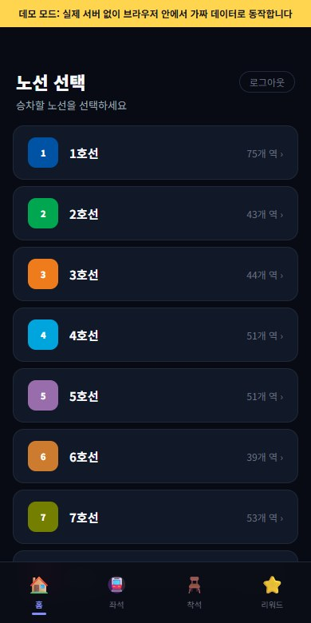
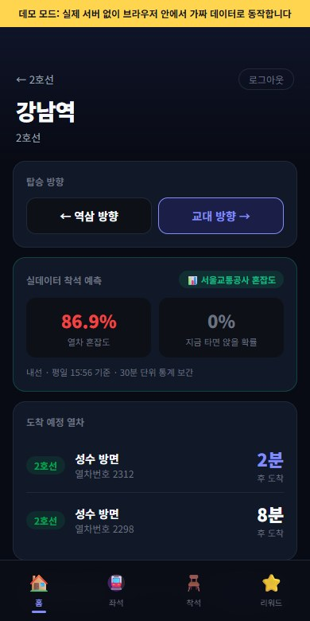
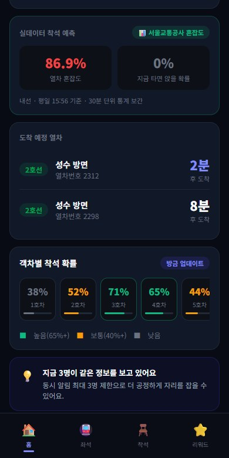

# Easit (이지잇) — 지하철 좌석 예측

> 🔗 **Live Demo**: https://easit-web.vercel.app

수도권 지하철에서 "이 열차에 타면 앉을 수 있을지, 몇 정거장 가면 자리가 날지"를 공공 혼잡도 통계로 계산해 보여 주는 모바일 웹 앱입니다.

**바로 써 보기: https://yeomhojun1.github.io/easit/**

## 이게 뭔가요

날씨 앱이 "내일 비 올 확률 70%"를 알려 주듯, Easit은 "지금 강남역에서 이 방향 열차를 타면 앉을 확률 0%, 세 정거장 뒤 삼성역까지 가면 99%"처럼 자리에 앉을 확률을 알려 줍니다.
서울교통공사가 공개한 역·방향·시간대별 혼잡도 숫자를 그대로 보여 주는 대신, 사람이 바로 판단할 수 있는 "앉을 확률"로 바꿔 보여 주는 것이 핵심입니다.

## 이런 분께 필요해요

- 매일 같은 노선으로 출퇴근하면서 "이번 열차를 보내고 다음 걸 탈까, 그냥 탈까"를 승강장에서 고민하는 분
- 오래 서 있기 힘들어서, 몇 정거장쯤 서서 가면 자리가 날지 미리 알고 싶은 분
- 처음 가는 노선에서 출근 시간대에 얼마나 붐비는지 감이 없는 분

## 화면으로 보기

<table>
  <tr>
    <td align="center"></td>
    <td align="center"></td>
    <td align="center"></td>
  </tr>
  <tr>
    <td align="center">1. 노선 선택<br>수도권 24개 노선 중 탈 노선을 고릅니다.</td>
    <td align="center">2. 강남역, 교대 방향<br>평일 15:56 기준 열차 혼잡도 86.9%, 지금 타면 앉을 확률 0%. 서울교통공사 자료로 계산한 실제 값입니다.</td>
    <td align="center">3. 칸별 착석 확률<br>1호차 38%, 3호차 71% 같은 칸별 숫자와 도착 예정 열차는 화면 구성을 보여 주기 위한 예시 값입니다.</td>
  </tr>
</table>

## 바로 써 보기

https://yeomhojun1.github.io/easit/ 에 접속하면 됩니다. 앱 설치나 회원가입이 필요 없습니다.
이 데모는 서버 없이 브라우저 안에서만 동작합니다. 화면 맨 위 노란 띠가 데모 모드라는 표시입니다.

1. 첫 화면에서 **데모 계정으로 바로 시작**을 누릅니다. 실제 계정이 아니며 아무 정보도 저장하지 않습니다.
2. 노선 목록에서 **2호선**을 누릅니다.
3. 역 목록에서 **강남**을 누릅니다.
4. **역삼 방향** 또는 **교대 방향**을 누릅니다. 지금 시각(요일·시간) 기준 열차 혼잡도와 "지금 타면 앉을 확률"이 나옵니다.
5. 아래로 내려 칸 하나를 누르면 상세 화면이 열립니다. 슬라이더를 움직이면 "몇 정거장 뒤 어느 역까지 가면 앉을 확률이 얼마인지"가 바뀝니다.
6. 상세 화면의 "좌석에 앉았어요"를 누르면 앉은 구역과 내릴 역을 알려 주고 포인트를 받는 흐름을 체험할 수 있습니다.

## 할 수 있는 것

서울교통공사 혼잡도 자료로 실제 계산하는 기능

- **지금 타면 앉을 확률**: 노선·역·방향을 고르면 지금 요일과 시각 기준 열차 혼잡도와 앉을 확률을 보여 줍니다. 1~8호선 중 서울교통공사가 운영하는 구간이 대상입니다.
- **몇 정거장 뒤에 앉을 확률**: 앞으로 지나갈 역들에서 사람이 얼마나 내리는지를 따져, 최대 15정거장 뒤까지 역별 누적 확률을 계산합니다.
- **분기 노선 구분**: 2호선 성수지선·신정지선처럼 갈라지는 구간도 본선과 섞이지 않게 따로 계산합니다.

예시 값으로 화면 구성만 보여 주는 기능

- **칸별 앉을 확률**(1~10호차)과 **칸 안 구역별 확률**(출입문 사이 3구역, 프리미엄 6구역): 숫자는 고정된 예시 값입니다. 실데이터가 있는 역에서는 구역 간 차이만 예시 비율을 쓰고, 전체 수준은 실제 계산값에 맞춥니다.
- **도착 예정 열차**(2분 후, 8분 후)와 "지금 3명이 같은 정보를 보고 있어요" 안내: 고정된 예시 문구입니다.
- **착석 기록과 포인트**: "좌석에 앉았어요" → 앉은 구역 → 내릴 역 → +1 포인트, 3포인트마다 프리미엄 1일. 흐름은 동작하지만 기록은 어디에도 저장되지 않고 새로고침하면 0으로 돌아갑니다.

그 밖에

- 9호선·신분당선·GTX-A 등 혼잡도 자료가 없는 노선과 구간은 "실데이터 미지원, 아래 확률은 데모 값"이라는 안내와 함께 예시 값을 보여 줍니다.
- 실제 서버로 실행하면 이메일 회원가입·로그인을 쓸 수 있고, 카카오·네이버·구글 로그인은 해당 키를 설정했을 때만 버튼이 나타납니다.

## 어떻게 동작하나요

**혼잡도 자료란.** 서울교통공사가 공공데이터포털에 공개하는 "지하철혼잡도정보"는 1~8호선 각 역에서 방향별로, 평일·토요일·일요일 각각 05:30부터 00:30까지 30분 단위로 열차가 얼마나 붐비는지를 퍼센트로 적어 둔 표입니다. 100%는 열차 정원만큼 탔다는 뜻이고, 한 칸 정원은 약 160명입니다. 이 앱은 2026-03-31자 자료(원본 1,671행)를 앱에서 쓰기 좋은 형태로 바꿔 저장소에 넣어 두었습니다.

**혼잡도를 "앉을 확률"로 바꾸는 방법.** 실제 코드(`backend/src/subway/seat-model.ts`)가 하는 일을 순서대로 적으면 다음과 같습니다.

1. **좌석이 다 차는 지점을 잡습니다.** 한 칸에 좌석이 54석이므로, 54 ÷ 160 ≈ 34%를 넘으면 서 있는 사람이 생긴다고 봅니다.
2. **지금 시각의 혼잡도를 구합니다.** 자료가 30분 단위라서 그 사이 시각은 앞뒤 두 값을 시간 비율대로 섞어 씁니다. 예를 들어 08:30이 91.1%, 09:00이 91.6%이면 08:45는 약 91.4%입니다.
3. **지금 타면 앉을 확률.** 혼잡도가 낮을수록 1에, 높을수록 0에 가까워지는 완만한 S자 곡선을 씁니다. 혼잡도 10%면 약 99%, 20%면 약 92%, 32%면 50%, 50%면 약 3%입니다. 좌석이 다 차기 직전(34%)에도 빈자리를 찾기 어렵다는 점을 반영해 50% 지점을 34%보다 조금 낮은 32%에 두었습니다.
4. **몇 정거장 뒤에 앉을 확률.** 진행 방향의 다음 역에서 혼잡도가 줄어든 만큼 사람이 내렸다고 봅니다. 내린 사람 중 앉아 있던 사람의 비율만큼 빈 좌석이 생기고, 그 좌석을 서 있던 사람들이 나눠 갖는다고 계산합니다. 역마다 "이 역에서 자리가 날 확률"을 구해 쌓아 가면 "여기까지 가는 동안 한 번이라도 앉을 확률"이 됩니다. 통계로 낸 추정이므로 최대 99%까지만 표시합니다.

예를 들어 평일 08:30 2호선 강남역에서 역삼 방향으로 타면, 혼잡도 91.1%라 지금 앉을 확률은 0%이지만 역삼까지 17%, 선릉까지 48%, 삼성까지 99%로 계산됩니다.

## 어떻게 만들었나요

이 앱은 AI 코딩 에이전트에게 구현을 맡기고, 별도의 테스트 에이전트에게 결과를 점검하게 하는 방식으로 만들었습니다. 사람은 무엇을 만들지 정하고, 에이전트가 낸 보고서를 읽고 무엇을 고칠지 판단하는 역할을 맡았습니다.

**1. 기능 전수 점검.** 테스트 에이전트가 기능 38개를 하나씩 실제로 실행해 보고 결과를 표로 남겼습니다([feature-test-report.md](feature-test-report.md)). 통과 25개, 실패 4개, 데이터베이스나 로그인 키가 없어 실행하지 못한 것 9개였고, 표 밖에서 찾은 결함이 4건 더 있었습니다.

**2. 찾아낸 대표적인 문제.**
- 2호선 신도림역에서 문래 방향을 고르면 출근 시간인데도 혼잡도 0%, 앉을 확률 99.8%로 나왔습니다. 수정 후에는 혼잡도 128.6%, 앉을 확률 0%입니다.
- 2호선 성수역에서 건대입구 방향을 고르면 방향이 반대로 계산되고, 다음 역으로 엉뚱한 지선 역들이 나왔습니다.
- 원인은 원본 자료에 같은 역 이름이 본선 승강장과 지선 승강장으로 두 번 들어 있어 나중 줄이 앞 줄을 덮어쓴 것, 그리고 노선의 역 순서를 역 번호 순으로 만든 탓에 1호선 동묘앞·8호선 남위례처럼 나중에 생긴 역이 엉뚱한 자리에 놓인 것이었습니다.
- 그 밖에 소셜 로그인 키가 없으면 서버가 아예 켜지지 않는 문제, 서버에 연결되지 않았는데도 "이 노선은 미지원"이라고 잘못 안내하는 문제, 회원가입 화면에 "생년월일은 저장하지 않는다"고 적혀 있지만 실제로는 저장하던 문제 등이 있었습니다.

**3. 수정과 재발 방지.** 노선 순서는 앱 화면의 노선표를 기준으로 삼고, 같은 이름의 승강장이 여러 개면 본선을 우선하도록 자료 변환 방식을 바꿨습니다. 그 결과 예측이 가능한 이웃 역 쌍이 504개에서 512개로 늘었고 줄어든 노선은 없었습니다. 같은 실수가 다시 생기지 않도록 이 사례들을 그대로 검사하는 자동 테스트 11개를 추가했습니다([fix-report.md](fix-report.md)).

**4. 서버 없이 도는 데모.** 누구나 링크 하나로 써 볼 수 있도록, 서버에서 하던 확률 계산을 브라우저 안에서 그대로 돌리는 데모 모드를 만들어 GitHub Pages에 올렸습니다. 옮기는 과정에서 계산이 달라지지 않았는지 확인하려고, 같은 입력을 서버 쪽 계산과 브라우저 쪽 계산에 넣어 17,064건을 비교했고 결과가 다른 경우는 0건이었습니다. README를 쓰면서 1~8호선 이웃 역 742쌍 × 요일 3종 × 시각 42개, 총 93,492건으로 넓혀 다시 비교했을 때도 불일치는 0건이었습니다.

## 아직 부족한 점

- **실제 사용자가 없습니다.** 개인 프로젝트로 만든 데모이며, 출퇴근하는 사람이 실제로 써 보고 의견을 준 적은 아직 없습니다.
- **예측이 현장과 얼마나 맞는지 검증하지 않았습니다.** 계산 방식은 "좌석 54석, 정원 160명"과 같은 가정에 기댄 추정이고, 실제 승강장에서 앉을 수 있었는지와 맞춰 본 적은 없습니다.
- **화면의 일부 숫자는 예시입니다.** 칸별·구역별 확률, 도착 예정 열차, "지금 3명이 보고 있어요" 같은 안내는 고정된 예시 값입니다.
- **실시간 열차 정보와 연결되어 있지 않습니다.** 서버에 실시간 도착 정보 기능의 코드는 있지만 별도 API 키가 필요하고, 앱 화면과는 아직 연결하지 않았습니다. 예측은 분기마다 갱신되는 통계(2026-03-31자 자료) 기준입니다.
- **다루는 범위가 좁습니다.** 실제 계산은 서울교통공사가 운영하는 1~8호선 구간만 됩니다. 1호선은 서울역~청량리 구간만 자료가 있고, 9호선·신분당선·경전철·GTX-A 등은 예시 값만 나옵니다.
- **사용자끼리 정보를 나누는 기능은 아직 없습니다.** "앉았어요"·내릴 역 입력과 포인트는 화면 흐름만 있고 저장되거나 다른 사용자에게 전달되지 않습니다.
- **실제 데이터베이스를 붙인 회원가입·로그인은 검증하지 못했습니다.** 테스트 환경에 데이터베이스가 없어, 대체 환경에서 서버 응답만 확인했습니다.

---

## 개발자용 정보

아래는 직접 실행하거나 코드를 고치려는 개발자를 위한 내용입니다.

### 데모 모드 (GitHub Pages)

`VITE_DEMO=true`로 빌드하면 백엔드 대신 브라우저 안의 가짜 API(`src/demo/`)가 응답합니다. 착석 예측은 `backend/data/congestion-model.json`을 그대로 불러와 `backend/src/subway/seat-model.ts`와 같은 계산(`src/demo/seatModel.js`)을 합니다. 백엔드 모델을 고치면 이 파일도 같이 고쳐야 합니다. 평소 빌드(`npm run build`)에는 데모 코드가 포함되지 않습니다.

```bash
VITE_DEMO=true npm run build   # base 가 /easit/ 로 바뀜
VITE_DEMO=true npm run preview # http://localhost:4173/easit/
```

`main`에 push하면 `.github/workflows/pages.yml`이 데모 빌드를 GitHub Pages에 배포합니다.

### 프로젝트 개요

(계획) 지하철 탑승객이 **좌석 현황을 체크인**하면, 다른 사용자는 **빈자리가 생길 확률이 높은 칸**을 미리 찾을 수 있는 서비스입니다. 현재는 체크인 화면 흐름만 있고, 체크인 내용이 저장되거나 다른 사용자의 예측에 쓰이지는 않습니다. (Easit 프로젝트의 초기 버전 — 더 발전된 버전은 [subwayApp](https://github.com/yeomhojun1/subwayApp))

### 주요 기능

- **실데이터 착석 확률 예측** — 서울교통공사 혼잡도 통계(1~8호선) 기반, 아래 상세
- (계획) 탑승 중인 열차·좌석 체크인 — 현재는 프론트 화면 흐름만 있고 서버에 저장하지 않음(포인트도 프론트 state)
- 노선/칸별 빈자리 예측 정보 확인 — 노선·역·방향별 확률은 실데이터, 칸별(`CARS`)·존별(`ZONES_3`/`ZONES_6`) 확률과 도착 예정 열차(`MOCK_TRAINS`)는 `src/constants.js`의 목업 값
- 카카오 · 네이버 · 구글 소셜 로그인 (키가 설정된 것만 버튼 노출, 없으면 이메일 로그인만)

### 착석 확률 예측 모델 (실데이터)

[서울교통공사 지하철혼잡도정보](https://www.data.go.kr/data/15071311/fileData.do)(공공데이터포털, KOGL 제1유형)를 기반으로,
역·방향·요일·30분 단위 혼잡도에서 **"지금 타면 앉을 확률"과 "k정거장 후 누적 착석 확률"**을 계산합니다.

**모델 아이디어** (전동차 1량 좌석 54석 / 정원 약 160명 → 혼잡도 34% ≈ 좌석 만석):

1. **즉시 착석**: 혼잡도 `c`의 로지스틱 함수 `1/(1+e^((c-32)/5))` — 혼잡 10%면 ~99%, 50%면 ~3%
2. **k정거장 후**: 진행 방향의 다음 역들에서 혼잡도가 줄어드는 만큼(하차) 좌석이 나고,
   서 있는 사람들이 경쟁한다고 보고 역마다 `p_i = 빈좌석/입석자`를 누적 — `P_k = 1-(1-P_0)·Π(1-p_i)`
3. 30분 슬롯 사이는 선형 보간, 상·하선(내·외선)은 프론트 `SUBWAY_LINES` 배열의 역 순서로 판별
4. 노선 순서의 정본은 프론트 `src/data/subway.js` — 같은 역명이 여러 승강장 코드로 오면(2호선 성수 211/9002)
   본선을 정본으로, 지선 승강장 시계열은 `성수(지선)` 같은 별도 키로 보존한다. 지선은 별도 트랙으로 조회

```bash
# 모델 재생성 (원본 CSV → JSON)
cd backend && node scripts/build-congestion-model.mjs

# 예측 API 스모크 테스트 (DB 불필요)
npm run build && node scripts/smoke-prediction.js

# 예측 모델 단위 테스트 (DB 불필요)
npm test
```

```
GET /api/subway/seat-prediction?line=2호선&station=강남&next=역삼&day=평일&time=08:30
→ { congestion: 91.1, pSitNow: 0, journey: [{ station: "역삼", pCumulative: 0.17 }, ...] }
```

> 인증 불필요·API 키 불필요. 9호선·경전철 등 데이터 밖 노선은 `supported: false`로 응답하고
> 앱은 데모 값으로 동작합니다. 데이터 출처: 서울교통공사_지하철혼잡도정보 (2026-03-31, 분기 갱신)

### 기술 스택

| 구분 | 기술 |
| --- | --- |
| Frontend | React · Vite |
| Backend | **NestJS** · TypeORM · PostgreSQL |
| 인증 | JWT · Passport (Kakao · Naver · Google OAuth) |

### 구조

```
easit/
├─ src/        # React (Vite) 프론트엔드
└─ backend/    # NestJS API 서버 (TypeORM + PostgreSQL)
```

### 실행 방법 (Docker 불필요)

#### 1. PostgreSQL 16

네이티브 설치(권장, Windows):

```powershell
# 설치 후 psql 로 DB·계정 생성
psql -U postgres -c "CREATE USER easit WITH PASSWORD 'easit1234';"
psql -U postgres -c "CREATE DATABASE easit OWNER easit;"
```

docker 가 있다면 DB만 컨테이너로 띄워도 됩니다 (`docker compose up -d db`).
테이블은 TypeORM `synchronize: true` 로 자동 생성됩니다.

#### 2. 환경변수

```bash
cp .env.example .env   # 소셜 로그인 키는 비워둬도 됩니다
```

#### 3. 실행

```bash
# 백엔드 (포트 4003)
cd backend
npm install
npm run start:dev

# 프론트엔드 (포트 5173, 루트)
npm install
npm run dev
```

> 소셜 로그인 키(`KAKAO_REST_API_KEY` 등)가 없으면 해당 전략을 아예 등록하지 않으므로
> 백엔드는 정상 기동하고, 프론트는 `GET /api/auth/providers` 응답에 따라 등록된 버튼만 보여줍니다.
> 미설정 프로바이더로 직접 접근하면 503 JSON 으로 응답합니다.

### 환경변수 (레포 루트의 `.env` — 백엔드가 `../.env`를 읽음)

```
PORT=4003
VITE_API_URL=http://localhost:4003/api

DB_HOST=localhost
DB_PORT=5432
DB_USER=easit
DB_PASS=easit1234
DB_NAME=easit

JWT_SECRET=32자_이상_랜덤_문자열   # 없으면 개발용 기본값으로 동작

# 선택 — 없으면 해당 소셜 버튼이 숨겨집니다
# KAKAO_REST_API_KEY=카카오_REST_API_키
KAKAO_CALLBACK_URL=http://localhost:4003/api/auth/kakao/callback
```

> `.env.example`을 복사해 `.env`를 만들어 값을 채워주세요.
